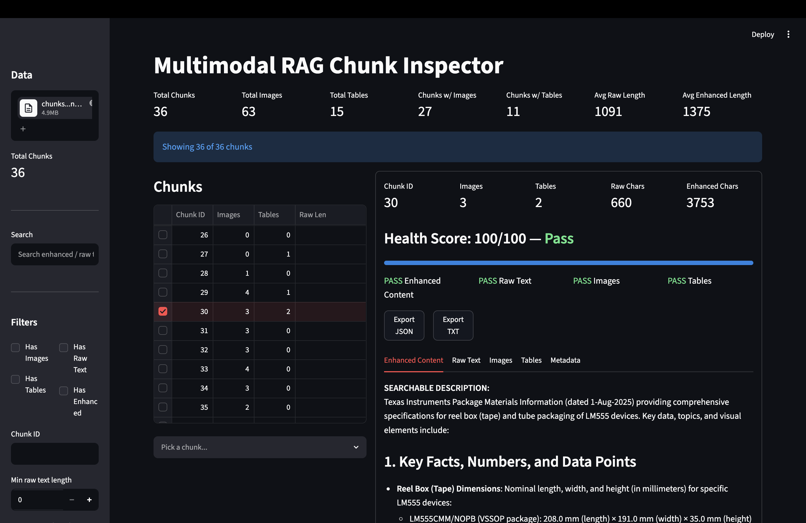
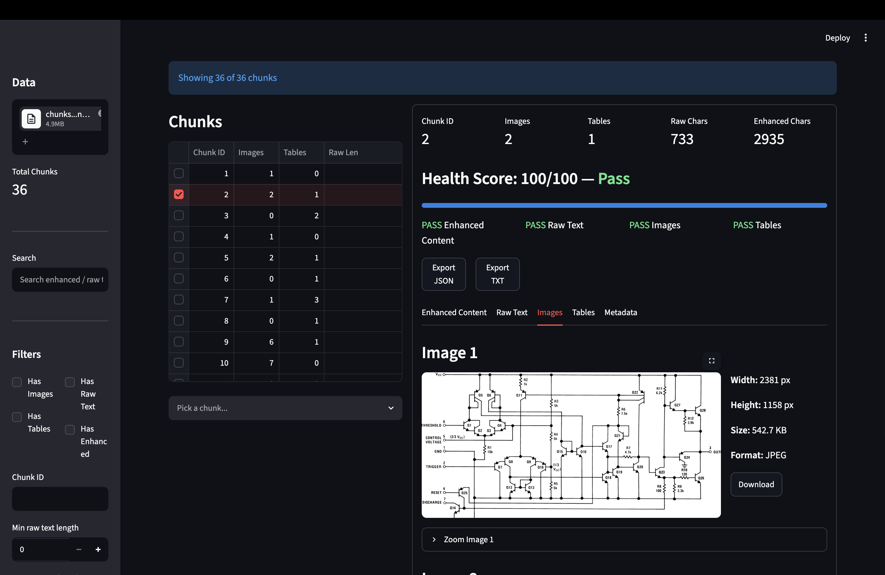
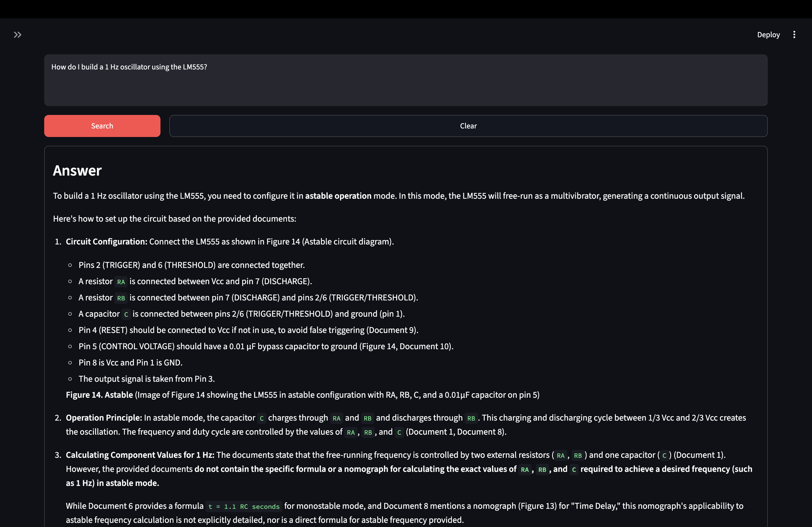
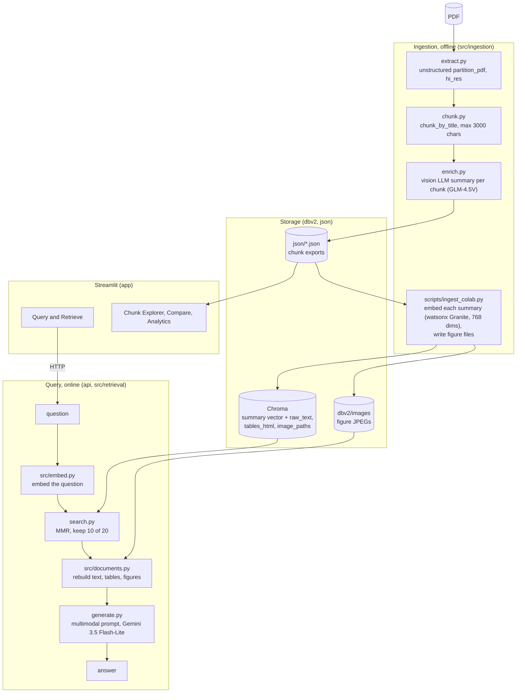

# Multimodal RAG for electronics documents

Ask questions about datasheets and application notes and get answers built from the text, the tables, and the figures in the document.

A PDF is split into sections, a vision model writes a searchable summary of each section, and the summaries are embedded and stored. At query time the nearest sections are retrieved, their original text, tables, and figures are rebuilt, and a multimodal LLM answers from them.

<div align="center">

[](https://www.python.org/)
[](https://fastapi.tiangolo.com/)
[](https://www.langchain.com/)
[](https://www.trychroma.com/)
[](https://www.ibm.com/watsonx)
[](https://ai.google.dev/)
[](https://streamlit.io/)

</div>

## Contents

- [What is in the repository](#what-is-in-the-repository)
- [Screenshots](#screenshots)
- [Architecture](#architecture)
- [Quick start](#quick-start)
- [Environment variables](#environment-variables)
- [Running the API](#running-the-api)
- [Running the dashboard](#running-the-dashboard)
- [Running with Docker](#running-with-docker)
- [Tests](#tests)
- [Ingesting a new PDF](#ingesting-a-new-pdf)
- [Configuration](#configuration)
- [Project structure](#project-structure)
- [Project status and documentation](#project-status-and-documentation)

## What is in the repository

- **A FastAPI backend** (`api/`) that retrieves chunks and generates answers, with a streaming endpoint.
- **A Streamlit dashboard** (`app/`) for asking questions and inspecting every stored chunk.
- **An offline ingestion pipeline** (`src/ingestion/`) that turns a PDF into chunks, summaries, and vectors.
- **A pre-built vector store** (`dbv2/`), so the API answers questions straight after cloning, with no ingestion run.

The store ships with five documents: 270 chunks and 267 figures.

| Document | Source name in the store | Chunks |
|---|---|---|
| Microchip AN699 (anti-aliasing filters) | `AN699chunks` | 29 |
| LM555 timer | `LM555TImer` | 36 |
| LM2596 step-down regulator | `lm2596chunks` | 73 |
| LM317 adjustable regulator | `lm317chunks` | 54 |
| TLV1117 LDO regulator | `tlv1117.pdfchunks_export` | 78 |

## Screenshots

| Chunk Explorer | Dataset Analytics | Query & Retrieve |
|---|---|---|
|  |  |  |

## Architecture

There are two pipelines that meet at the vector store. Ingestion runs offline, once per document. The query path runs on every request.



### Why only the summary is embedded

A raw datasheet chunk mixes prose, an HTML table, and figures, and an embedding model reads only text. The vision model writes one plain-text summary that describes all three, and that summary is what gets embedded and searched. The original text, the tables, and the figure paths ride along as metadata, so the answer is built from the source material, not from the summary.

### How each kind of content is handled

| Content | Extraction | Storage | At query time |
|---|---|---|---|
| Text | `partition_pdf` returns the text of each element | `raw_text` in the chunk metadata | Added to the prompt as written |
| Tables | `infer_table_structure=True` produces HTML tables | `tables_html` (a JSON list) in the chunk metadata | Added to the prompt as HTML |
| Figures | `extract_image_block_types=["Image"]` returns each figure | A JPEG in `dbv2/images`; its path in `image_paths` | Attached to the prompt as images and served to the UI by URL |

### The stack

| Step | What runs | Where |
|---|---|---|
| PDF parsing | `unstructured` with the `hi_res` strategy | local, ingestion only |
| Chunking | `chunk_by_title` | local, ingestion only |
| Summaries | `zai-org/GLM-4.5V` through the Hugging Face router | hosted, ingestion only |
| Embeddings | `ibm/granite-embedding-278m-multilingual` (768 dimensions) | IBM watsonx.ai |
| Vector store | Chroma, cosine similarity, HNSW index | embedded, on disk in `dbv2/chroma_db` |
| Retrieval | MMR: fetch the 20 nearest chunks, keep 10 that differ from each other | `src/retrieval/search.py` |
| Generation | `gemini-3.5-flash-lite`; other providers through `/query/custom` | Google Gemini API |
| Tracing | LangSmith (optional) | hosted |

The terms used here (MMR, HNSW, SSE, and so on) are explained in [docs/GLOSSARY.md](docs/GLOSSARY.md).

## Quick start

You need Python 3.13 and three credentials: a Gemini API key, and a watsonx.ai API key with its project id. The vector store is already built, so no PDF parsing tools are needed to run the API and the dashboard.

Clone the repository:

```bash
git clone https://github.com/moksh-m9u/Multimodal-Rag.git
```

```bash
cd Multimodal-Rag
```

Create and activate a virtual environment:

```bash
python3.13 -m venv .venv
```

```bash
source .venv/bin/activate
```

Install the dependencies. This is the full set (API, dashboard, ingestion, tests):

```bash
pip install -r requirements.txt
```

To run only the API, the smaller set is enough:

```bash
pip install -r requirements-api.txt
```

Create a `.env` file in the repository root with the variables from [Environment variables](#environment-variables), then check that the code imports and the tests pass:

```bash
python -m pytest -q -p no:cacheprovider
```

Start the API in one terminal:

```bash
uvicorn api.main:app --reload --port 8001
```

Start the dashboard in a second terminal (activate the virtual environment there too):

```bash
API_BASE_URL=http://127.0.0.1:8001 streamlit run app/dashboard.py
```

Open http://localhost:8501 and ask a question on the Query & Retrieve page.

## Environment variables

Put these in `.env` in the repository root. Write the values without quotes: `docker run --env-file` reads each line literally, so a quoted value reaches the container with the quotes included. `.env` is ignored by git; never commit it.

```
GEMINI_API_KEY=your_gemini_api_key
WATSONX_API_KEY=your_ibm_cloud_api_key
WATSONX_PROJECT_ID=your_watsonx_project_id
WATSONX_URL=https://eu-de.ml.cloud.ibm.com
```

| Variable | Needed for | Notes |
|---|---|---|
| `GEMINI_API_KEY` | Answer generation | Create one at [aistudio.google.com/apikey](https://aistudio.google.com/apikey) |
| `WATSONX_API_KEY` | Embedding every question, and every chunk at ingestion | An IBM Cloud API key |
| `WATSONX_PROJECT_ID` | Same | The id of your watsonx.ai project |
| `WATSONX_URL` | Same | Region endpoint; defaults to `https://eu-de.ml.cloud.ibm.com` |
| `HF_TOKEN` | Ingestion only (chunk summaries); also the default key for Hugging Face models in `/query/custom` | Create one at [huggingface.co/settings/tokens](https://huggingface.co/settings/tokens) |
| `GROQ_API_KEY`, `OPENAI_API_KEY` | Optional default keys for those providers in `/query/custom` | A key can also be sent with the request |
| `API_BASE_URL` | Dashboard | Where the dashboard finds the API; defaults to `http://localhost:8000` |
| `CORS_ALLOWED_ORIGINS` | API | Comma-separated origins allowed to call the API from a browser |
| `GENERATION_MAX_TOKENS` | API | Output token limit per answer; defaults to 512 |
| `LANGSMITH_API_KEY`, `LANGSMITH_TRACING`, `LANGSMITH_PROJECT` | Optional tracing | Leave unset to run without tracing |
| `UNSTRUCTURED_API_KEY`, `UNSTRUCTURED_URL` | Not used by the code yet | For Unstructured's hosted Parse API, the planned production parser |

## Running the API

```bash
uvicorn api.main:app --reload --port 8001
```

The first request to `/health` should return `{"status":"ok","vector_store":"loaded"}`:

```bash
curl http://127.0.0.1:8001/health
```

Interactive documentation is at http://127.0.0.1:8001/docs.

| Method | Path | Purpose |
|---|---|---|
| GET | `/` | Lists the endpoints |
| GET | `/health` | Reports whether the vector store loaded |
| POST | `/retrieve` | Returns the retrieved chunks, with no LLM call |
| POST | `/query` | Retrieves, then answers with the default model |
| GET | `/query/stream` | The same, streamed token by token over Server-Sent Events |
| POST | `/query/custom` | The same retrieval, answered by a provider and model chosen in the request |
| GET | `/images/{response_id}/{index}` | Serves a figure returned by an earlier response |

Retrieve chunks only:

```bash
curl -X POST http://127.0.0.1:8001/retrieve -H 'Content-Type: application/json' -d '{"query": "LM555 astable operation frequency formula", "top_k": 10}'
```

Ask a question:

```bash
curl -X POST http://127.0.0.1:8001/query -H 'Content-Type: application/json' -d '{"query": "What is the dropout voltage of the TLV1117?"}'
```

Stream an answer:

```bash
curl -N --get http://127.0.0.1:8001/query/stream --data-urlencode 'query=What is the output voltage range of the LM317?'
```

The full request and response shapes are in [API.md](API.md).

Opening the Chroma store rewrites tracked files under `dbv2/chroma_db`. After running the API from a clone you intend to commit from, restore them:

```bash
git checkout -- dbv2/chroma_db
```

## Running the dashboard

```bash
API_BASE_URL=http://127.0.0.1:8001 streamlit run app/dashboard.py
```

| Page | Purpose | Data source |
|---|---|---|
| Home | Overview of the pages | none |
| Query & Retrieve | Ask a question, watch the answer stream, see the chunks and figures behind it | the API |
| Chunk Explorer | Browse every chunk: summary, raw text, tables, figures, health score | `json/*.json` |
| Compare Chunks | Two chunks side by side | `json/*.json` |
| Dataset Analytics | Histograms and top-20 lists per document | `json/*.json` |

The three browsing pages still read the JSON exports from disk instead of asking the API. Moving them behind the API is planned (Checkpoint 4 in [AGENTS.md](AGENTS.md)).

A second, smaller app shows evaluation results:

```bash
streamlit run app/rag_eval_dashboard.py
```

There is also a command-line query script that prompts for a question:

```bash
python -m scripts.query
```

## Running with Docker

The image contains only the backend code and the pre-built store (`api/`, `src/`, `config/`, `dbv2/`). It is about 1.17 GB and holds no secrets; credentials are passed at run time.

Build:

```bash
docker build -t multimodal-rag-api .
```

Run:

```bash
docker run --rm -p 8000:8000 --env-file .env multimodal-rag-api
```

Check:

```bash
curl http://127.0.0.1:8000/health
```

On an Apple Silicon Mac the build above produces a `linux/arm64` image. To build for an amd64 server and push it to Docker Hub, log in and replace `<user>` with your Docker Hub username:

```bash
docker login
```

```bash
docker buildx build --platform linux/amd64 -t <user>/multimodal-rag-api:latest --push .
```

## Tests

The suite runs without network access; external clients are mocked.

```bash
python -m pytest -q -p no:cacheprovider
```

Run one file or one test:

```bash
python -m pytest -q -p no:cacheprovider tests/test_embed.py
```

## Ingesting a new PDF

Ingestion is not needed to use the five documents that ship with the repository. Read this section before running it:

- It calls the vision model once per chunk through the Hugging Face router, which needs `HF_TOKEN` and available credit on that account.
- It calls watsonx once per chunk for the embedding.
- It writes to the tracked store in `dbv2/chroma_db`, so it changes files that git tracks.
- There are two ways to build the store today, and they store figures differently. The shipped store was built the second way.

| Script | Input | What it stores |
|---|---|---|
| `python -m scripts.ingest` | a PDF | Parses, chunks, summarises, writes `chunks_huggingface.json` in the repository root, and adds records that keep the figures as base64 inside Chroma |
| `python -m scripts.ingest_colab` | the JSON exports in `json/` | Embeds the existing summaries, writes each figure to `dbv2/images`, and adds records that hold the figure paths and a `source` name |

The query path reads both shapes (`src/documents.py`).

PDF parsing needs system packages:

```bash
brew install poppler tesseract libmagic pandoc
```

On Ubuntu or Debian:

```bash
sudo apt-get install -y poppler-utils tesseract-ocr libmagic1 pandoc
```

Run the pipeline on one PDF:

```bash
python -m scripts.ingest path/to/document.pdf
```

With no argument it uses `data/datasheet.pdf`.

Uploading a PDF through the API, with a hosted parser in production, is the goal of Checkpoint 7 in [AGENTS.md](AGENTS.md).

## Configuration

Every tunable lives in `config/settings.py`.

| Setting | Value | Purpose |
|---|---|---|
| `EMBEDDING_MODEL` | `ibm/granite-embedding-278m-multilingual` | Embedding model on watsonx.ai; changing it means re-indexing |
| `EMBEDDING_MAX_INPUT_TOKENS` | `512` | The model's input limit; longer text is truncated |
| `GENERATION_MODEL` | `gemini-3.5-flash-lite` | Default answer model |
| `GENERATION_MAX_TOKENS` | `512` | Output limit per answer (environment variable) |
| `RETRIEVAL_SEARCH_TYPE` | `mmr` | Retrieval method |
| `RETRIEVAL_K` | `10` | Chunks returned |
| `RETRIEVAL_FETCH_K` | `20` | Candidates fetched before MMR picks `RETRIEVAL_K` |
| `CHROMA_PERSIST_DIR` | `dbv2/chroma_db` | Vector store location |
| `IMAGES_DIR` | `dbv2/images` | Figure files |
| `PDF_STRATEGY` | `hi_res` | `unstructured` parsing mode |
| `CHUNK_MAX_CHARACTERS` | `3000` | Largest chunk |
| `ENHANCEMENT_MODEL` | `zai-org/GLM-4.5V` | Vision model that writes the chunk summaries |

The providers and models offered by `/query/custom` are listed in `config/providers.py`.

## Project structure

```
config/
  settings.py            every tunable and environment variable
  providers.py           LLM providers and models for /query/custom
src/
  embed.py               the one embedding factory (watsonx Granite)
  documents.py           turns stored chunk metadata back into text, tables, figures
  tracing.py             LangSmith helpers
  ingestion/             offline: PDF -> elements -> chunks -> summaries -> Chroma
    extract.py             unstructured partition_pdf
    chunk.py               chunk_by_title
    enrich.py              vision LLM summary per chunk
    export.py              chunks -> JSON export
    pipeline.py            writes the Chroma store
  retrieval/
    search.py              loads Chroma, builds the MMR retriever, retrieves
    generate.py            builds the multimodal prompt, calls the LLM, streams
api/
  main.py                FastAPI app and endpoints
  service.py             owns the store and retriever for the process
  custom_service.py      /query/custom: same retrieval, user-chosen LLM
  images.py              serves figure JPEGs by URL
  schemas.py             request and response models
app/
  dashboard.py           Streamlit UI
  api_client.py          the only place the UI talks to the backend
  rag_eval_dashboard.py  Streamlit viewer for evaluation results
scripts/                 command-line entry points (ingest, query, Colab ingestion)
dbv2/                    the built Chroma store and the figure images
json/                    per-document chunk exports used by the dashboard
data/                    source PDFs
evals/                   evaluation questions and notes
tests/                   pytest suite (no network)
docs/                    trade-offs, product research, glossary
Dockerfile               backend image
requirements.txt         everything
requirements-api.txt     the backend only (used by the Dockerfile)
```

## Project status and documentation

The current phase is a refactor that makes the codebase small and explainable before new features are added. Planned next, in order: a split of the API into routers with a `/v1` prefix, an evaluation baseline, a move from Chroma to Postgres with pgvector, and PDF upload through the API.

| Document | What it holds |
|---|---|
| [AGENTS.md](AGENTS.md) | Working rules, architecture rules, decisions made, and the checkpoint plan with its status |
| [docs/TRADEOFFS.md](docs/TRADEOFFS.md) | Why each component is built the way it is, the alternatives, and the current choice |
| [docs/PRODUCT_RESEARCH.md](docs/PRODUCT_RESEARCH.md) | What people who upload datasheets need, and where this project can stand out |
| [docs/GLOSSARY.md](docs/GLOSSARY.md) | Plain-language explanations of the technical terms |
| [API.md](API.md) | Request and response shapes for every endpoint |
